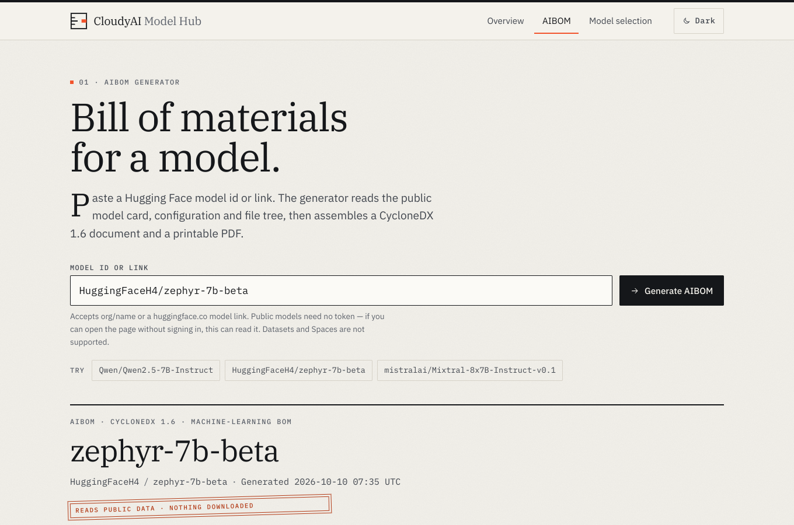
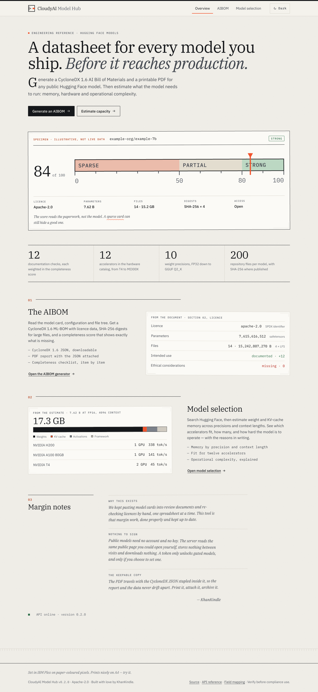
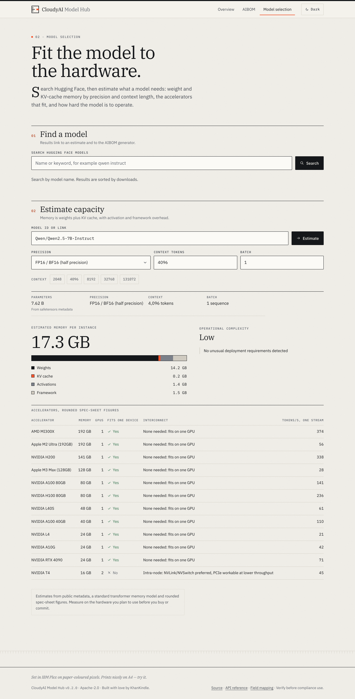
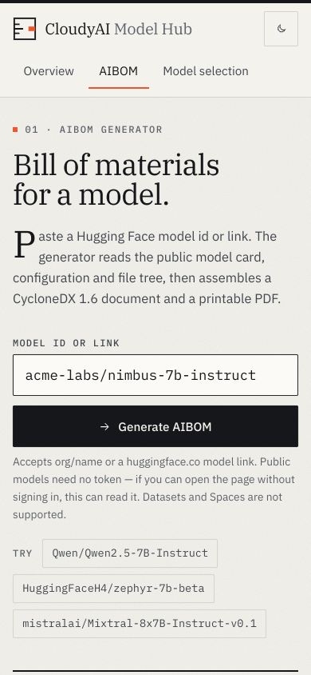

# CloudyAI Model Hub

Generate CycloneDX 1.6 **AI Bills of Materials (AIBOMs)** for Hugging Face models, download them as a **PDF report**, and estimate what a model needs to run: memory, accelerators and operational complexity.

[](https://vercel.com/new/clone?repository-url=https%3A%2F%2Fgithub.com%2Fcloudyai-co%2Fcloudyai_model_hub&project-name=cloudyai-model-hub&repository-name=cloudyai-model-hub)



## Features

- **AIBOM generator.** Enter a Hugging Face model id (`org/name`) or a `huggingface.co` link. The app reads the public model card, `config.json` and file tree, then builds a CycloneDX 1.6 `machine-learning-model` BOM. It lists each file in the repository as a component (up to 200), with SHA-256 digests where the Hub publishes them.
- **Completeness score.** A weighted checklist of twelve documentation items, such as licence, intended use, limitations and evaluation results. It gives a score from 0 to 100, a rating of strong, partial or sparse, and shows each item. See [the AIBOM mapping reference](docs/aibom-mapping.md).
- **PDF report.** A printable A4 version of the same AIBOM: a cover, eight numbered sections, a file digest table, the completeness checklist and verification notes. The CycloneDX JSON is attached inside the PDF as `aibom.cdx.json`. See [the PDF report guide](docs/pdf-report.md).
- **Model selection.** Search Hugging Face, then estimate memory for ten weight precisions at any context length and batch size. Results show the accelerators that fit, GPU counts, a single-stream throughput ceiling, a complexity rating with reasons, and related models. See [the capacity model](docs/capacity-model.md).
- **Datasheet interface.** The UI is styled as an engineering datasheet, with light and dark themes and no third-party requests from the browser. There is no frontend build step and no framework: the frontend is plain HTML, CSS and ES modules, served by the same backend.
- **No account needed.** Everything reads public Hub metadata — model card, `config.json`, file list — and downloads nothing, so public models work with no token and no sign-in. `HF_TOKEN` is optional and only unlocks gated or private models.

| Overview | Model selection | Mobile |
|---|---|---|
|  |  |  |

## Quick start

You need Python 3.11 or newer. Node 22 or newer is only needed for the JavaScript checks.

```bash
git clone https://github.com/cloudyai-co/cloudyai_model_hub.git
cd cloudyai_model_hub
./run.sh
```

Open <http://localhost:8000>. The first run creates `.venv` and installs the project in editable mode with its development extras. Later runs reuse the environment.

- `./run.sh --offline` also starts a bundled fixture hub on port 8787 and points the app at it, so you can work without internet access. Only the four fixture models are available. See [backend/tests/fixtures/README.md](backend/tests/fixtures/README.md).
- Public models need no token at all. For gated or private models, export `HF_TOKEN` before you start the server. The token stays on the server and is never sent to the browser.

Manual setup, for example on Windows or in an existing environment:

```bash
python3 -m venv .venv && source .venv/bin/activate   # Windows: .venv\Scripts\activate
pip install -e ".[dev]"
uvicorn backend.main:app --port 8000
```

## Using the API

The API is documented interactively at <http://localhost:8000/api/docs> (generated by FastAPI from the code), and the OpenAPI schema is at `/api/openapi.json`.

```bash
# AIBOM as CycloneDX 1.6 JSON
curl "http://localhost:8000/api/aibom/generate?model=Qwen/Qwen2.5-7B-Instruct"

# The same AIBOM as a PDF, saved as Qwen-Qwen2.5-7B-Instruct-aibom.pdf
curl -OJ "http://localhost:8000/api/aibom/report.pdf?model=Qwen/Qwen2.5-7B-Instruct"

# Memory and hardware estimate for int4 weights with an 8192-token context
curl "http://localhost:8000/api/requirements?model=Qwen/Qwen2.5-7B-Instruct&dtype=int4&context_length=8192"
```

The full reference is in [docs/api.md](docs/api.md).

## Configuration

Every setting is optional. The app reads these environment variables when a request is handled.

| Variable | Default | Purpose |
|---|---|---|
| `HF_TOKEN` | unset | Access token for gated or private repositories. |
| `HF_ENDPOINT` | `https://huggingface.co` | Base URL of the Hub API. Point it at a mirror or the offline fixture hub. |
| `HUB_CACHE_TTL_SECONDS` | `600` | How long Hub responses stay in memory. `0` turns the cache off. |
| `HUB_CACHE_MAX_ENTRIES` | `256` | Upper bound on cached responses per process. |
| `HUB_HTTP_TIMEOUT_SECONDS` | `12` | Timeout for each request the server makes to the Hub. |

Details and examples are in [docs/configuration.md](docs/configuration.md).

## How it works

```
 Browser (ES modules, hash router)
     │  same-origin requests to /api/*
     ▼
 FastAPI app: backend/main.py
     ├── hf_client.py  ──►  Hugging Face Hub API     (cached in memory, parts fetched in parallel)
     ├── aibom.py      ──►  CycloneDX 1.6 BOM + completeness score
     ├── capacity.py   ──►  memory, hardware fit, throughput, complexity
     └── report.py     ──►  PDF (reportlab) with the BOM attached (pypdf)
```

Nothing is stored between requests. The architecture, cache design and security model are described in [docs/architecture.md](docs/architecture.md).

## How the numbers are calculated

- **Parameter count.** When the repository has safetensors weights, the Hub reports the exact count and the app uses it. Otherwise the count is estimated from `config.json` for standard decoder-only transformers. The estimate is labelled as an estimate. It is not exact for encoder-decoder, multimodal or unusual architectures.
- **Memory.** Weights (parameters × bytes per element) + KV cache + 10% activation overhead + 1.5 GB fixed framework overhead. The KV cache accounts for grouped-query attention when `num_key_value_heads` is present, and it is never estimated below 16-bit precision.
- **Hardware fit.** `ceil(total memory ÷ accelerator VRAM)` against a catalog of twelve accelerators. A model that fits on one GPU needs no interconnect. Two to eight GPUs on one node should use NVLink or NVSwitch, and PCIe works at lower throughput. More than eight GPUs need multi-node InfiniBand or RoCE.
- **Throughput.** Memory bandwidth ÷ weight bytes read per GPU. This is a theoretical ceiling for one request stream, not a benchmark. Batching servers serve many requests at once and reach much higher aggregate throughput.
- **Operational complexity.** A transparent heuristic, not a certification. It flags gated repositories, `trust_remote_code`, mixture-of-experts models, multimodal pipelines, large memory footprints and licences outside a common permissive list. Each reason is shown next to the Low, Medium, High or Very High label.
- **Completeness score.** A weighted checklist of twelve items. Section text (intended use, limitations, ethics, users) comes from the model card, matched on the headings Hugging Face's template uses, such as "Bias, Risks, and Limitations".

The derivations and worked examples are in [docs/capacity-model.md](docs/capacity-model.md) and [docs/aibom-mapping.md](docs/aibom-mapping.md).

## Repository layout

```
backend/                  FastAPI application (Python package)
  main.py                 routes, static mount, security headers, CORS
  settings.py             environment configuration
  hf_client.py            Hub client: id normalisation, fetching, error mapping
  cache.py                in-memory TTL cache
  aibom.py                CycloneDX builder and completeness score
  capacity.py             memory, hardware fit, throughput, complexity
  report.py               PDF report (reportlab) and attachment (pypdf)
  assets/fonts/           PDF fonts: renamed IBM Plex subsets (SIL OFL 1.1)
  tests/                  pytest suite: fixtures, vendored schemas, no network
frontend/                 zero-build UI, served as static files
  index.html              shell, icon sprite, masthead and footer
  css/app.css             datasheet theme (light and dark tokens)
  css/fonts.css           generated @font-face rules
  fonts/                  IBM Plex WOFF2 files (SIL OFL 1.1)
  js/                     ES modules: router, api, format, theme, views/, components/
scripts/                  font build, font CSS, offline Hub, JavaScript syntax check
tests/js/                 Node unit tests for the frontend modules
docs/                     architecture, API, mappings, PDF, deployment, fonts, screenshots
.github/                  CI workflow, issue and pull request templates, Dependabot
```

## Testing and quality checks

```bash
pytest                    # API, AIBOM, PDF, capacity, schema validation, static frontend checks
ruff check . && ruff format --check .
npm test                  # frontend unit tests (Node 22+)
npm run check             # syntax check of every ES module
```

The CI workflow in `.github/workflows/ci.yml` runs all of these on Python 3.11, 3.12 and 3.13, and on Node 22.

## Deploy to Vercel

The app runs on Vercel's Python (FastAPI) runtime. The API runs as one function, and the frontend is served from Vercel's CDN.

1. Click **Deploy with Vercel** at the top of this page, or import the repository in the Vercel dashboard.
2. Keep the default build settings. The entrypoint (`backend.main:app`) is set in `pyproject.toml`, and function limits and security headers are set in `vercel.json`.
3. Optionally add `HF_TOKEN` as an environment variable, then deploy.
4. Check `https://<your-deployment>/api/health`.

The full guide, including limits and troubleshooting, is in [docs/deploy-vercel.md](docs/deploy-vercel.md).

## Privacy and hosting

- The app has no sign-in, no accounts and no stored history. It does not keep the models you look up. Hub responses are cached in memory for ten minutes by default, per running instance.
- The server talks to `huggingface.co`. The browser talks only to the app's own origin, and fonts are served from that origin too. The strict Content-Security-Policy blocks other sources.
- A public deployment is open to anyone who can reach it. If you set `HF_TOKEN`, every visitor's request uses that token. Use a read-only token that you are comfortable sharing with all of the deployment's users.

## Known limitations

- Every capacity figure is an estimate. Confirm it on your target hardware before you buy or commit to a deployment.
- Section extraction matches Hugging Face's standard template headings. A well-documented model that uses other headings scores lower than it deserves.
- There is no sign-in, no per-user access control and no history. Those would be needed before you run the app for a team.
- The test suite validates generated AIBOMs against the vendored CycloneDX 1.6 schema. For compliance work, validate them again with the official tools in your own pipeline. A valid BOM is not proof that its contents are accurate.
- The PDF is a report of public metadata. It is not a legal opinion, a licence determination or a certification. Its footer reminds readers to verify it before compliance use, and section 08 repeats the full disclaimer.

## Contributing, security and conduct

- [CONTRIBUTING.md](CONTRIBUTING.md) explains the development setup, the checks and the design rules.
- [SECURITY.md](SECURITY.md) explains how to report a vulnerability privately.
- [CODE_OF_CONDUCT.md](CODE_OF_CONDUCT.md) sets the expectations for participation.
- [CHANGELOG.md](CHANGELOG.md) lists the changes in each release.

Pull requests are welcome.

## Licence

Licensed under the [Apache License 2.0](LICENSE). The bundled IBM Plex fonts are licensed under the SIL Open Font License 1.1. See [docs/fonts-and-licences.md](docs/fonts-and-licences.md).

Built with love by KhanKindle.
