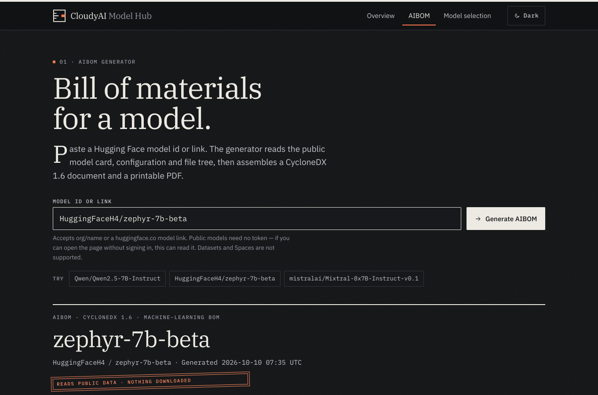

# Architecture

CloudyAI Model Hub is one FastAPI application. It serves a JSON API and a static frontend. It reads public metadata from the Hugging Face Hub and produces three things: a CycloneDX 1.6 AI Bill of Materials (AIBOM), a PDF report of that AIBOM, and a capacity estimate for running the model. Nothing is written to a database or to disk while a request is handled.

## System overview

```
Browser
  frontend/index.html, css/, js/        ES modules, hash router, no build step
        │  fetch("/api/...")            same origin
        ▼
FastAPI application: backend/main.py
  ├─ /api/health, /api/dtypes, /api/models/search     catalogue and search
  ├─ /api/aibom/generate                              JSON AIBOM and completeness
  ├─ /api/aibom/report.pdf                            PDF with the BOM attached
  ├─ /api/requirements                                memory, hardware, complexity
  └─ "/"  StaticFiles(frontend/)                      mounted last

  hf_client.fetch_bundle() ──► Hugging Face Hub API (HF_ENDPOINT)
        │   in-memory TTL cache (cache.py), successful responses only
        ├─► aibom.py      build_aibom(), score_completeness()
        ├─► capacity.py   build_requirements_report(), recommend_hardware()
        └─► report.py     render_report_pdf()   (reportlab, then pypdf attaches the BOM)
```

## Request flows

### AIBOM and completeness: `GET /api/aibom/generate`

1. FastAPI validates the `model` parameter (at most 200 characters, otherwise `422`).
2. `hf_client.normalize_model_id()` turns the input into a canonical `org/name` id. It rejects input longer than 140 characters and any other invalid input with `400`, before any network call.
3. `fetch_bundle()` fetches the model metadata first. That request is required, and its answer decides whether the model exists. It then fetches the raw README, the raw `config.json` and the recursive file tree (at most 10 pages) in parallel. If one of those fails, the BOM is still built without that part, and the completeness score reflects the gap.
4. `build_aibom()` assembles the CycloneDX document. `score_completeness()` evaluates the twelve checks.
5. The response is `{model_id, aibom, completeness}`.

### PDF report: `GET /api/aibom/report.pdf`

The same steps run, then `render_report_pdf()` draws the report with reportlab and attaches the BOM with pypdf. The response is `application/pdf`, sent as an attachment with `Cache-Control: no-store`. The renderer keeps no per-request state. Locally, a fully documented model renders in about 0.2 seconds.

### Model selection: `GET /api/requirements`

This route fetches the model metadata, the README and `config.json`, but not the file tree. `build_requirements_report()` computes the parameter count, memory, hardware fit and complexity. A second Hub request searches for models with the same `model_type`, which become the alternatives. If that search fails, the list is empty and the estimate is still returned.

## Backend modules

| Module | Responsibility |
|---|---|
| `main.py` | Routes, validation, error mapping, CORS, security headers for non-API responses, static mount. |
| `settings.py` | Reads `HF_ENDPOINT`, `HF_TOKEN`, the cache limits and the request timeout. Read on each request, so tests and long-running processes can change them. |
| `hf_client.py` | Hub client: id normalisation, HTTP calls, `HubError` and its subclasses (each with an HTTP status), `fetch_bundle()`, and search. |
| `cache.py` | Bounded in-memory TTL cache. Per process: instances do not share it. |
| `aibom.py` | CycloneDX 1.6 builder, README section extraction, file roles, completeness checks and levels. |
| `capacity.py` | Parameter estimate from `config.json`, memory formula, precision table, accelerator catalogue, throughput, complexity rules. |
| `report.py` | PDF layout, bundled fonts, CJK fallback, the file digest and checklist sections, and the attachment. |

**Errors.** Invalid model ids return `400`. Hub failures keep their own status codes (`403`, `404`, `429`, `502`), each with a short message written for people. FastAPI returns `422` for invalid query parameters. `build_requirements_report()` raises `ValueError` when no parameter count can be found, which the route maps to `422`.

## Caching

- Each entry is keyed by the kind of data, the model id, and a 16-character SHA-256 prefix of the access token, or `anon` when no token is set. One user's private data is therefore never served to a request that uses a different token.
- Only successful responses are stored. Errors are not cached, so a retry reaches the Hub again.
- Entries live for `HUB_CACHE_TTL_SECONDS` (default 600). The cache holds at most `HUB_CACHE_MAX_ENTRIES` entries (default 256).
- The cache is in memory and per process. On Vercel, each warm instance has its own cache, and a cold start begins empty.

## Frontend

- `main.js` starts the app. It applies the saved theme, starts the router, and fills the footer version from `/api/health`.
- `router.js` maps hash routes to views: `#/` for the overview, `#/aibom?model=…` for the AIBOM datasheet, and `#/selection` for model selection, with its search and capacity settings in the query string. Each render aborts the previous view's pending requests with an `AbortController`.
- `api.js` wraps `fetch` with a 60-second timeout and turns error responses into `ApiError` values that carry the server's message. `downloadFile()` fetches the PDF or JSON as a Blob and saves it through a temporary object URL.
- `dom.js` provides `h()`, `svg()`, `icon()`, `append()`, `clear()` and `copyText()`. Text is always set with `textContent`.
- `components/` holds the reusable parts: buttons, fields, tables, badges, the checklist, alerts, and the completeness ruler (`ruler.js`).
- `views/` holds the screens: `overview.js`, `aibom.js` with `datasheet.js`, and `selection.js`.
- `format.js` holds the number, size and date formatting. `theme.js` stores the choice in `localStorage` under `cloudyai-theme`.

## Design system

The interface is laid out as an engineering datasheet, not as a dashboard.

- **Paper and ink.** Warm off-white paper with near-black ink. The dark theme inverts both. The colours are CSS custom properties in `frontend/css/app.css`.
- **Type.** IBM Plex Serif for headings, IBM Plex Sans for text, and IBM Plex Mono for data and labels. The fonts are self-hosted WOFF2 files, each limited to a `unicode-range` subset.
- **Structure.** Numbered sections (01, 02 and so on), hairline rules, tables with uppercase monospace headers, and the completeness ruler.
- **Restraint.** No gradients, no decorative shadows, no emoji and no purple accents. Icons are inline SVG symbols from one sprite in `index.html`.
- **Composition.** The front page avoids the stock hero-plus-card layout. It is an editorial sequence in which no two sections share a template: a full-width statement, an opened specimen sheet with crop marks, a hairline data band, alternating instrument rows built from real document fragments, and margin notes on a sticky rail.
- **Margin voice.** A human layer keeps the sheet from reading as machine output: serif-italic margin notes, a wavy pencil underline, an ink stamp ("reads public data · nothing downloaded"), drop caps and a faint paper grain. Notes never carry required information, so the page stays scannable, and the stamp's claim is repeated in plain prose in the forms and the README.
- **Accessibility.** Visible focus states, labelled controls, `role="alert"` for errors, `role="status"` for progress, and support for `prefers-reduced-motion`.



## Security model

- **Content-Security-Policy.** Non-API responses send `default-src 'self'`, `script-src 'self'`, `style-src 'self'`, `connect-src 'self'`, `object-src 'none'` and `frame-ancestors 'none'`. On Vercel these come from `vercel.json`. Locally, middleware in `main.py` sets them.
- **No inline code.** There are no inline scripts, no `style` attributes and no inline event handlers. Dynamic widths are set through the CSSOM. The static tests fail if a change adds one.
- **Escaping.** Text from the Hub is rendered with `textContent`. External links must use HTTPS (`safeHttpsUrl`).
- **Server-side Hub access.** The browser never calls Hugging Face. Links to model pages open in a new tab.
- **Other headers.** `X-Content-Type-Options: nosniff`, `X-Frame-Options: DENY`, `Referrer-Policy: strict-origin-when-cross-origin`, and a restrictive `Permissions-Policy`.
- **CORS.** The API accepts GET, HEAD and OPTIONS requests from any origin, without credentials. Other sites can therefore call the read-only endpoints from a browser.

## Deployment topology

- **Vercel.** `backend/main.py` is the FastAPI entrypoint, run as a Python function. `frontend/` is promoted to Vercel's CDN (`[tool.vercel.fastapi.static] cdn = true`). Routes under `/api` are declared before the static mount, so they take precedence. See [deploy-vercel.md](deploy-vercel.md).
- **Local.** `uvicorn backend.main:app` serves the API and the frontend from one process.
- **Tests.** The test suite runs the app in-process through `httpx`. The Hub is replaced by `backend/tests/fake_hub.py`, so no network access is needed.

## Design decisions

1. **No build step for the frontend.** This is the project's founding principle. The source files are the shipped files, and debugging means reloading the page.
2. **Stateless.** Nothing is stored between requests. That means no database, and the app can scale out. The cache only saves Hub calls.
3. **Read-only, fail-soft Hub access.** The app never writes to the Hub. Optional parts (README, config, file tree) can fail without failing the whole BOM.
4. **Standards first.** The BOM is CycloneDX 1.6, checked in the tests against the vendored schemas. Hugging Face-specific data goes into `hf:*` properties, so the standard fields stay clean.
5. **Renamed PDF fonts.** The PDF uses renamed TrueType subsets of IBM Plex, because the OFL does not allow modified versions to use the reserved name "Plex". See [fonts-and-licences.md](fonts-and-licences.md).
6. **Labelled heuristics.** Estimates, scores and complexity ratings state their method and their reasons, so people can judge them for themselves.
